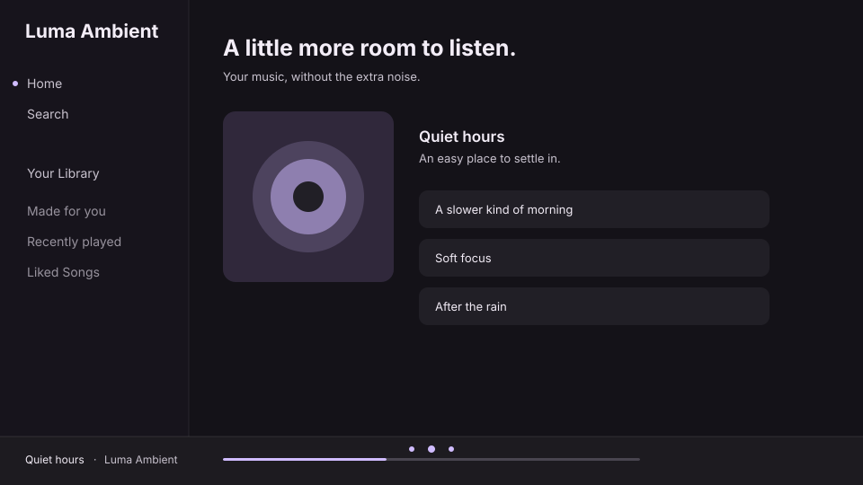

# Luma Ambient

A focused Spotify desktop interface for Spicetify, built around Material 3 surfaces, Material Symbols transport icons, and an artwork-reactive color system when paired with Luma Lyrics.

Luma Ambient is a standalone Spicetify theme with built-in, automatically applied CSS styling for the separate Luma Lyrics extension.

## Features

- Full Material You (Material 3) design system: tonal surface roles, state layers, shape scale, and elevation — flat surfaces, no gradients.
- Two coordinated schemes: **Ambient** and **Ambient Soft**.
- A generated Material You palette: the full Material 3 role set is built from the playing track's artwork (or a color you choose), with nine palette styles, light and dark appearance, and adjustable contrast. See [Material You palette](#material-you-palette).
- Colors cross-fade when the track changes (disabled when reduced motion is requested).
- Luma Lyrics' **Desktop colors** palette still works; both schemes remain the standalone fallback.
- Material Symbols Rounded icons for labelled playback controls.
- A minimal Now Playing sidebar that preserves the player and lyrics preview; Credits, On tour, Merch, and Next in queue are removed entirely (including leftover wrappers).
- Home keeps your shortcut grid, followed shows, and Recents while removing the recommendation shelves; each shelf has an independent visibility control.
- Home shortcuts and content cards use a consistent rounded surface style with quiet spacing and hover feedback.
- Consistent surface, text, border, spacing, and radius tokens.
- Calmer navigation, cards, track rows, search, and now-playing bar.
- Essential navigation, search, playback, focus indicators, and selected states remain visible.
- Reduced-motion support and no unnecessary animated effects.
- Optional compact-spacing rules in `declutter.css`.
- Native Luma Lyrics styling scoped to its fullscreen overlay, player controls, settings, and artwork-derived Material You palette.

## Preview



This is an illustrative theme preview, not a screenshot of Spotify. Real Spotify screenshots will be added after a manual desktop test.

## Install as a standalone theme

1. Install and configure [Spicetify](https://spicetify.app/docs/getting-started).
2. Download this repository and run the installer from the theme folder:

   - Linux/macOS:

     ```bash
     ./install.sh
     ```

     Or without downloading first:

     ```bash
     curl -fsSL https://raw.githubusercontent.com/Shahisha1/Luma-Ambient/main/install.sh | bash
     ```

   - Windows (PowerShell):

     ```powershell
     .\install.ps1
     ```

   The installer copies the theme (including its `theme.js` setup script) into your Spicetify Themes directory, enables JS injection, and applies. It is safe to re-run for updates, and it preserves your existing color scheme if the theme is already active.

3. To switch schemes manually:

   ```bash
   spicetify config current_theme Luma-Ambient color_scheme ambient-soft
   spicetify apply
   ```

The scheme names correspond to the sections in `color.ini`.

### Manual install

If you prefer not to run the installer, copy the theme folder into your Spicetify `Themes/` directory, then:

```bash
spicetify config current_theme Luma-Ambient color_scheme ambient
spicetify config inject_theme_js 1
spicetify apply
```

## First-run setup

The theme script `theme.js` (injected automatically with `inject_theme_js 1`, the same mechanism the Comfy theme uses) asks once on the first launch whether the [Luma Lyrics](https://github.com/Shahisha1/Luma-Lyrics) extension is installed, and adapts the interface to your answer — for example, hiding Spotify's native lyrics button while Luma Lyrics is active so the playbar keeps a single lyrics toggle instead of two.

Luma Lyrics and Luma Plus are detected automatically afterwards, so the setup stays correct if you install or remove them later without prompting again. The prompt only appears once; your answer is stored in `localStorage`.

To change your answer later, open Spotify's console and run `LumaAmbient.ask()`, or `LumaAmbient.reset()` to forget the saved answer. Dismissing the prompt (Escape or clicking outside) leaves everything untouched and asks again on the next launch.

If you prefer no prompt at all, delete `theme.js` from the installed theme folder and run `spicetify config inject_theme_js 0 && spicetify apply`; the theme then behaves as pure CSS.

## Material You tokens

`color.ini` defines a full Material 3 role set per scheme (`surface`, `surface-container-*`, `on-surface*`, `primary`, `primary-container`, `secondary`, `tertiary`, `error`, `outline*`, `inverse-*`, `scrim`, …). `user.css` maps them onto `--md-*` tokens used by every surface, and also keeps the legacy Spicetify aliases (`--spice-main`, `--spice-sidebar`, `--spice-player`, `--spice-card`, `--spice-button`, `--spice-text`, `--spice-subtext`, …) so existing customizations and Luma Lyrics' **Desktop colors** mapping keep working — the artwork palette drives the main surfaces automatically.

`color.ini` and the `--md-*` values in `user.css` are the static fallback; with the palette source set to *Album artwork* or *Custom color* they are overridden at runtime by the generated palette.

State layers (hover/pressed/selected), the shape scale (`--md-shape-xs/sm/md/lg/xl`), spacing, elevation, and the font stack are all tokens, so a scheme can be re-skinned by editing `color.ini` alone.

## Material You palette

`theme.js` generates the complete Material 3 color role set — primary, secondary, tertiary and error with their containers, five surface container levels, outline and inverse roles, and the fixed roles — using Google's [Material Color Utilities](https://github.com/material-foundation/material-color-utilities) (the HCT color space). The result is applied as the `--md-*` variables, and as the legacy `--spice-*` keys that native Spotify surfaces read.

Open the settings from Spotify's profile menu (**Luma Ambient palette**) or run `LumaAmbient.palette.open()` in the console. Changes apply immediately and are remembered.

| Setting | Options |
|---|---|
| Color source | **Album artwork** (the seed is the current track's cover colors, taken with Spicetify's color extractor), **Custom color**, or **Theme scheme only** (nothing is generated; `color.ini` and Luma Lyrics' Desktop colors apply as before) |
| Style | Tonal spot, Vibrant, Expressive, Neutral, Monochrome, Fidelity, Content, Fruit salad, Rainbow |
| Appearance | Dark, Light, Match system |
| Contrast | Reduced, Standard, Medium, High |

The same settings are available from the console:

```js
LumaAmbient.palette.set({ variant: "vibrant", mode: "auto" });
LumaAmbient.palette.set({ source: "custom", seed: "#6750a4" });
LumaAmbient.palette.get();     // current settings
LumaAmbient.palette.reset();   // back to the defaults
```

If a track has no extractable artwork (local files, some podcasts), the last palette is kept.

**Luma Lyrics.** Luma Lyrics' **Desktop colors** also writes the `--spice-*` keys, so with the source set to *Album artwork* whichever of the two updates last wins. To let Luma Lyrics drive the colors, set the source to *Theme scheme only*.

**Light appearance** is new: a few fixed-dark details (the Luma Lyrics overlay shade and some shadows) are not retuned for it yet.

## Hiding and restoring sections

By default the theme removes:

- **Now Playing sidebar:** Credits, On tour, Merch, Next in queue (the player, lyrics preview and header are never touched).
- **Home shelves:** Your top mixes, Made for you, More like …, Fans also like, Based on your recent listening. Your shortcut grid, **Your shows** and **Recents** stay.

`theme.js` finds these sections by reading their headings and tags them (together with any empty wrappers they leave behind), so a Spotify markup change cannot blank a panel; `user.css` decides whether a tagged section is visible. Section matching uses Spotify's English headings, so in other languages the sections stay visible. The console logs each hidden section as `[Luma Ambient] decluttered: …`.

To show sections again, add variables to the end of `user.css` and run `spicetify apply`. A group variable restores everything in the group, and a per-section variable restores just one:

```css
:root {
  --luma-declutter-npv: block;      /* Credits, On tour, Merch, Next in queue */
  --luma-declutter-shelves: block;  /* every hidden Home shelf */
}
```

```css
:root {
  --ambient-sidebar-hidden: block;                  /* concert and shop links */
  --ambient-home-top-mixes: block;
  --ambient-home-made-for-you: block;
  --ambient-home-more-like: block;
  --ambient-home-fans-also-like: block;
  --ambient-home-recent-recommendations: block;
}
```

Set only the variables for what you want to show; remove them to hide the sections again. Both kinds of variable work for every section, and the per-section one wins. Spotify may change its headings and labels between client versions.

## Optional decluttering

For tighter spacing, append the contents of `declutter.css` to the end of your theme's `user.css`, then run `spicetify apply`.

To undo it, remove the block between the `LUMA DECLUTTER START` and `LUMA DECLUTTER END` comments from `user.css` and apply again. No essential controls or navigation items are hidden.

## Luma Lyrics compatibility

Luma Ambient includes a dedicated styling layer for your [Luma Lyrics](https://github.com/Shahisha1/Luma-Lyrics) Spicetify extension. When Luma Ambient is active, the extension's fullscreen lyrics view and settings panel automatically pick up the theme's restrained surfaces and typography.

### What the integration changes

- Styles the Luma Lyrics toolbar, player controls, settings panel, form controls, and lyric typography.
- Luma Lyrics derives a tonal palette from the current artwork and publishes it through Spotify's `--spice-*` color variables when Desktop colors is enabled. With the palette source set to *Theme scheme only*, Luma Ambient uses those variables for the app surfaces, player, selection and hover states, and accent; its selected `color.ini` scheme remains the fallback when Desktop colors is off. With the default *Album artwork* source, Luma Ambient generates the full palette itself (see [Material You palette](#material-you-palette)).
- To enable the shared desktop palette, open Luma Lyrics settings and turn on **Desktop colors**. The theme follows the extension's setting rather than reading its private palette variables directly.
- Keeps the extension's own artwork backdrop, lyric timing, word-by-word highlighting, scroll behavior, translations, romanization, and player logic intact.
- Requires the Luma Lyrics **Desktop colors** setting for artwork colors to appear in Spotify; lyrics overlay styling works independently.
- Is scoped to `#luma-root`; it does not globally restyle other extensions or change their lyric interfaces.

### Install / update

1. Update Luma Ambient in your Spicetify Themes folder so its `user.css` contains the Luma Lyrics integration block.
2. Keep **Luma Ambient** selected as your active Spicetify theme.
3. Make sure `luma-lyrics.js` is installed and enabled as a Spicetify extension.
4. Apply and reload Spotify:

   ```bash
   spicetify apply
   ```

5. Open Luma Lyrics from its playbar button. The theme integration is automatic; no CSS needs to be pasted into the extension or its repository.

If you previously copied an older version of Luma Ambient into your theme folder, replace its `user.css` with the current repository version before applying.

### Compatibility boundary

This is a CSS integration with the current Luma Lyrics v2 DOM structure, not a fork or modification of the extension. If Luma Lyrics changes its `#luma-root` markup or class names in a future update, some styling may need to be refreshed. The theme does not modify the extension's JavaScript, settings storage, LRCLIB requests, or playback controls.

## Manual test matrix

The following checks are required before calling a release fully verified. They have **not** been run in a live Spotify client in this repository-editing environment.

| Area | Standalone: both schemes | Luma Ambient + Luma Lyrics |
|---|---|---|
| Palette | Each source, each style, dark/light/system, contrast levels; colors change with the track; the settings dialog opens from the profile menu | Check which palette wins with Desktop colors on, and that *Theme scheme only* hands control back |
| Home | Check spacing, cards, headings, scroll | Check Spotify shell and return from lyrics |
| Search | Check search field, results, filters | Check search and navigation remain unaffected |
| Playlists | Check headers, rows, selected/hover states | Check playlist content and controls remain unaffected |
| Library | Check navigation, filters, saved items | Check sidebar and library interactions remain unaffected |
| Playback | Check play/pause, seek, volume, queue, device controls; every playbar icon (play/pause, previous/next, shuffle, repeat and repeat-one, like and liked, volume and mute) shows the Material glyph | Check extension transport and Spotify player controls |
| Lyrics | Not a built-in Luma feature | Check overlay, word/line/gentle/static modes, translation, romanization, artwork-reactive Material 3 desktop colors, and settings |
| Now Playing sidebar | Check player and lyrics preview remain; concert/shop links are hidden | Check the same minimal sidebar and confirm artwork palette updates |
| Accessibility | Keyboard focus, contrast, reduced motion | Check overlay focus, contrast, reduced motion, and keyboard operation |

Also verify Spotify's current client version and Spicetify version after every major Spotify UI update. Spotify's generated class names can change.

## Troubleshooting

- **Theme does not appear:** confirm the folder is named exactly `Luma-Ambient` and contains both `color.ini` and `user.css`.
- **Scheme does not change:** use the exact scheme name (`ambient` or `ambient-soft`) and run `spicetify apply`.
- **Changes do not appear:** fully reload Spotify after applying. Check the Spicetify CLI output for errors.
- **A Spotify update breaks a selector:** inspect the affected element in Spotify's developer tools and update only the corresponding narrow selector.

## Project files

- `color.ini` — Spicetify color schemes.
- `user.css` — standalone theme styling and design tokens.
- `declutter.css` — optional compact-spacing add-on.
- `theme.js` — built theme script (palette engine and first-run setup), injected with `inject_theme_js 1`. Generated from `src/`; do not edit by hand.
- `src/` — sources for `theme.js`: `palette.js` (Material 3 palette generation), `engine.js` (applies the palette and the settings dialog), `ui.js` (shared dialog and toast), `theme.js` (entry point, setup prompt and decluttering).
- `scripts/` — `build.mjs` bundles `src/` into `theme.js`; `test-palette.mjs` checks the generated palettes.
- `package.json` — development scripts and dependencies (not needed to install the theme).
- `install.sh`, `install.ps1` — one-step installer; `uninstall.sh`, `uninstall.ps1` remove the theme.
- `manifest.json` — Spicetify Marketplace-style theme metadata.
- `preview.svg` — illustrative preview.

## Development

The installed theme needs no build step: `theme.js` is generated and committed. To change the script, edit the files in `src/` and rebuild:

```bash
npm install
npm run build   # bundles src/ into theme.js
npm test        # palette checks: every role, text contrast, config handling
```

Commit `src/` and the rebuilt `theme.js` together.

## Version

Current development version: **1.4.0**.

See [CHANGELOG.md](CHANGELOG.md) for changes.

## License and attribution

No license file was present in the original repository, so this update does not assign a new license or claim MIT licensing. Until the repository owner adds an explicit license, the source remains under the default copyright terms. Luma Lyrics remains a separate extension; this theme only supplies scoped CSS styling and does not bundle or redistribute its code.

`theme.js` bundles [Material Color Utilities](https://github.com/material-foundation/material-color-utilities) by Google LLC, which is licensed under the Apache License 2.0; its notice is kept at the end of the built file.

Spotify is a trademark of Spotify AB. Spicetify is an independent community project.
